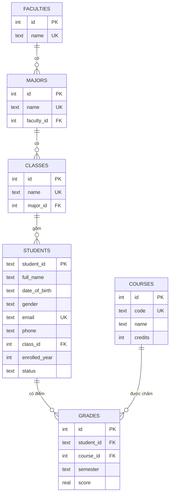

# Thiết kế database

Academic API dùng **SQLite** (module `node:sqlite` có sẵn trong Node ≥ 22.13). File database nằm ở `data/academic.db`, tự tạo khi chạy server lần đầu. Câu lệnh tạo bảng: [`src/database/schema.sql`](../src/database/schema.sql).

## Sơ đồ quan hệ (ERD)

## Mô tả các bảng

| Bảng | Vai trò | Ràng buộc chính |
|---|---|---|
| `faculties` | Khoa | `name` duy nhất |
| `majors` | Ngành học, thuộc một khoa | `name` duy nhất; `faculty_id` → `faculties` |
| `classes` | Lớp, thuộc một ngành | `name` duy nhất; `major_id` → `majors` |
| `students` | Sinh viên, thuộc một lớp | `student_id` là khóa chính (dạng `SV2022001`); `email` duy nhất; `gender` ∈ {Nam, Nữ}; `class_id` → `classes` |
| `courses` | Môn học | `code` duy nhất; `credits` > 0 |
| `grades` | Điểm của sinh viên theo môn và học kỳ | `score` từ 0 đến 10; duy nhất theo (`student_id`, `course_id`, `semester`) |

Khoa, ngành, lớp có quan hệ phân cấp một-nhiều, nên từ một sinh viên suy ra được lớp → ngành → khoa. Bảng `grades` là bảng trung gian nối sinh viên với môn học (quan hệ nhiều-nhiều, mỗi dòng có thêm học kỳ và điểm).

Khóa ngoại được bật (`PRAGMA foreign_keys = ON`), nên database từ chối dữ liệu tham chiếu sai. Tầng service còn kiểm tra trước để trả về lỗi 400/409 dễ hiểu thay vì lỗi database.

## Dữ liệu mẫu

Nằm trong `src/database/seed/data/`, mỗi bảng một file: 3 khoa, 5 ngành, 6 lớp, 20 sinh viên (`SV2022001`–`SV2022020`), 9 môn học và 60 điểm. Nạp lại bằng `npm run seed` (xóa dữ liệu cũ).

Một số sinh viên được chọn để kiểm thử các trường hợp đặc biệt: `SV2022008` (Bảo lưu, chưa có điểm), `SV2022015` (có môn không đạt), `SV2022019` (Bảo lưu, có điểm).
